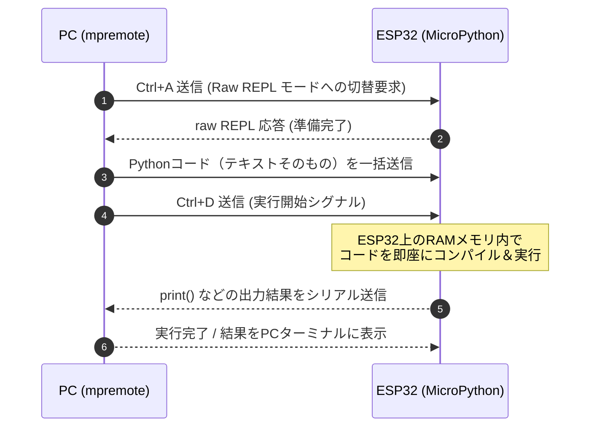

# ESP32 & MicroPython の仕組みとハードウェア解説

後学のための技術メモです。ESP32基板のボタンの役割や、PCからコードが転送・実行される内部の仕組みについてまとめています。

---

## 1. 基板上の2つのボタンの役割

ESP32開発ボードには通常、USBコネクタ付近に2つのプッシュボタン（タクトスイッチ）が配置されています。

```
       ┌──────────────────┐
       │     [ USB ]      │
       │                  │
[ EN ] │                  │ [ BOOT ]
(RST)  │  [ ESP32 Chip ]  │ (IO0)
       │                  │
       └──────────────────┘
```

| ボタン名 | 接続ピン | 役割・用途 |
| :--- | :--- | :--- |
| **EN (RST)** | `EN` (CHIP_PU) | **ハードウェアリセット（再起動）**<br>押すとチップへの電源/有効化が遮断され、離すと再起動します。プログラムがフリーズした時や最初からやり直したい時に使用します。 |
| **BOOT (IO0)** | `GPIO 0` | **起動モード切り替え ＆ ユーザー入力**<br>・起動時に押されていると「ROMブートローダーモード（書き込み待機）」に入ります。<br>・起動後はプログラム側から **通常のプッシュボタン入力** として読み取れます。 |

> [!TIP]
> **BOOTボタンをプログラムで使う例:**  
> `Pin(0, Pin.IN)` で読み取ると、ボタンを押した時に `0`（Low）、離した時に `1`（High）が取得できるため、外付けスイッチなしでボタン入力を試せます。

---

## 2. コード転送と実行の仕組み

MicroPythonでは、C言語（Arduinoなど）のように毎回機械語バイナリをフラッシュROMに焼き直すのではなく、**「ESP32内に常駐するPythonエンジンにテキストコードを送信してその場で実行させる」** 方式をとっています。

### 通信経路


### `mpremote run` 実行時のシーケンス（Raw REPL モード）

MicroPythonはシリアルポート越しに常に Python の対話画面（REPL: `>>> `）を開いて待機しています。  
`mpremote` は人間向けの対話モードではなく、機械通信専用の **Raw REPL（生データモード）** を使ってコードを送信します。



### Arduino（C/C++）との比較

| 項目 | Arduino (C/C++) | MicroPython (`mpremote run`) |
| :--- | :--- | :--- |
| **送信データ** | チップ専用の機械語バイナリ | **Pythonコード（テキスト）** |
| **書き込み先** | フラッシュROM全体（再消去＆書き換え） | **ESP32のRAM（メモリ）** |
| **所要時間** | コンパイル＆書き込みで十数秒〜数十秒 | **1〜2秒で即座に実行** |
| **フラッシュ寿命** | 書き換えるたびにROM寿命を消費 | メモリ実行のためROMへの書き込み負荷なし |

---

## 3. 本体への保存と自動起動（スタンドアロン動作）

PCから切り離し、モバイルバッテリーやUSB充電器につなぐだけで動かしたい場合は、ESP32内部の **ファイルシステム（仮想ストレージ）** にファイルを保存します。

```powershell
# blink.py を ESP32 本体の main.py として保存
uv run --with mpremote mpremote connect COM3 cp blink.py :main.py
```

### ESP32 起動時のファイル読み込み順
1. **`boot.py`**（存在する場合）：ハードウェアの初期化やWi-Fi接続設定などを記述。
2. **`main.py`**（存在する場合）：メインアプリケーション。`boot.py` の完了後に自動実行されます。

これにより、PCがなくても電源さえ供給されれば独立したIoTデバイスとして動作します。
